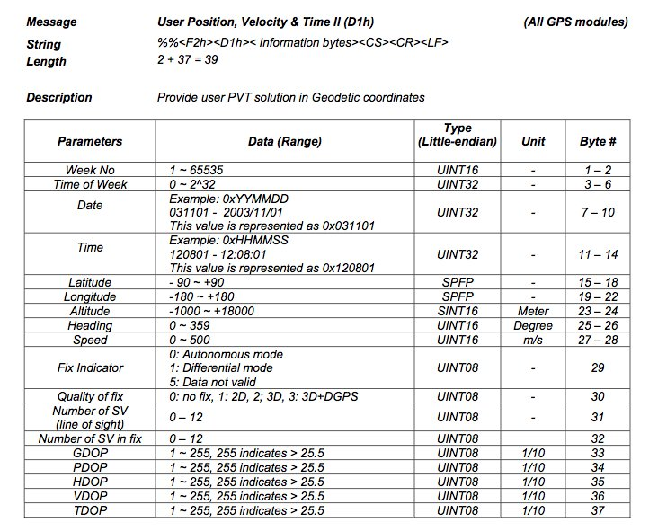
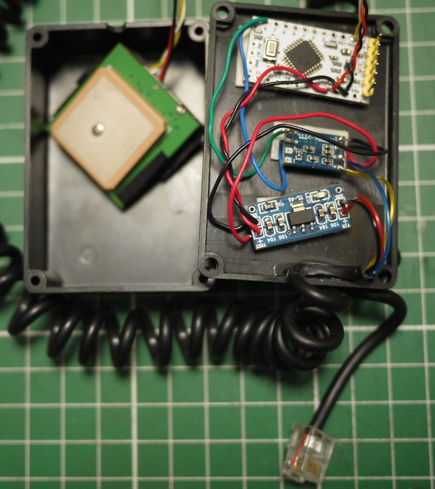

# SynScanGPS

Emulate a SynScan GPS using an Arduino (or a Raspberry Pi Pico, see "pico" branch) and a cheap GPS

# Hardware
- Arduino Mini
- 12v -> 5v convertissor
- RS232/TTL adaptor
- RJ cable to the SynScan (12v & RS232)
- A GPS receiver (configured at 4800 bauds, the code is not stable for faster speed, see issue #2)

# Hardware RP2040
 - for DualCore version and SynScan Hancontroller V5 version 6.4.0.1 try RP2040dualCore branch
 - any new GPS receiver configured on 115200Bd
 - using 2 core code can split functionality and data sharing for each serial port
 - adapted VPRHELI (Vladimir Pribyl)

 

Thanks to keymlinux for the latitude/longitude encoding